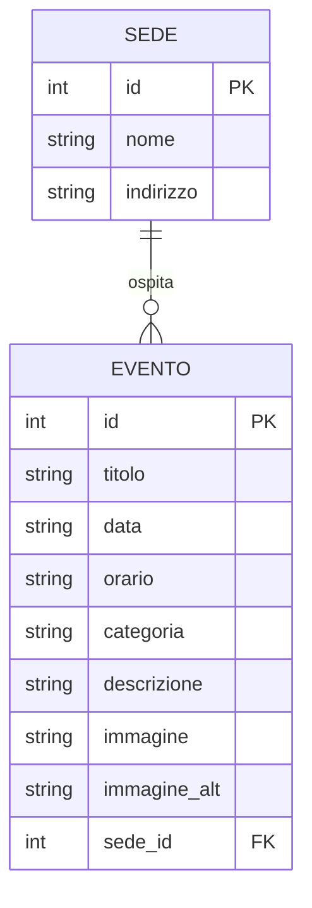

# Schema dei dati — Segnale

## 1. Entità

Il progetto utilizza due entità:

- **Evento:** rappresenta un appuntamento del festival.
- **Sede:** rappresenta un luogo in cui si svolgono gli eventi.

I dati sono conservati nei file `eventi.json` e `sedi.json`.

## 2. Campi delle entità

### Entità Evento (eventi.json)

| Campo | Tipo | Esempio |
|---|---|---|
| id | Numero intero | 1 |
| titolo | Stringa | Lettere in movimento |
| data | Stringa (AAAA-MM-GG) | 2026-06-12 |
| orario | Stringa (HH:MM) | 10:00 |
| categoria | Stringa | Incontro |
| descrizione | Stringa | Come cambia un messaggio quando cambiano le lettere? |
| immagine | Stringa | assets/lettere-in-movimento.svg |
| immagine_alt | Stringa | Lettere geometriche disposte su una griglia |
| sede_id | Numero intero | 1 |

## 3. Chiavi primarie

Entrambe le entità utilizzano il campo `id` come chiave primaria.

L'identificativo è:

- Numerico: espresso attraverso un numero intero.
- Univoco: non si ripete all'interno della stessa entità.
- Stabile: non cambia quando vengono modificate le altre informazioni.

## 4. Relazione tra le entità

Una sede può ospitare più eventi, mentre ogni evento
si svolge in una sola sede.

Si tratta di una relazione uno-a-molti (1:N).

Il campo `Evento.sede_id` fa riferimento al campo `Sede.id`.

## 5. Quantità dei dati

Il progetto contiene:

- 6 eventi nel file `eventi.json`.
- 3 sedi nel file `sedi.json`.

Ogni sede ospita attualmente due eventi.

## 6. Modalità di aggiornamento

I dati vengono aggiornati dal responsabile del sito,
modificando direttamente i file JSON nella repository
del progetto.

Una volta salvate e pubblicate le modifiche, la pagina
Programma mostra i dati aggiornati senza dover
modificare manualmente le schede HTML.

## 7. Informazioni mostrate dalla pagina

La pagina Programma mostra le schede degli eventi
generate dinamicamente attraverso JavaScript.

Ogni scheda contiene:

- Titolo dell'evento.
- Data e orario.
- Categoria.
- Descrizione.
- Immagine con testo alternativo.
- Nome della sede associata.

Le informazioni degli eventi vengono recuperate da
`eventi.json`, mentre il nome della sede viene
recuperato da `sedi.json` attraverso il campo `sede_id`.

## 8. Schema Evento–Sede

